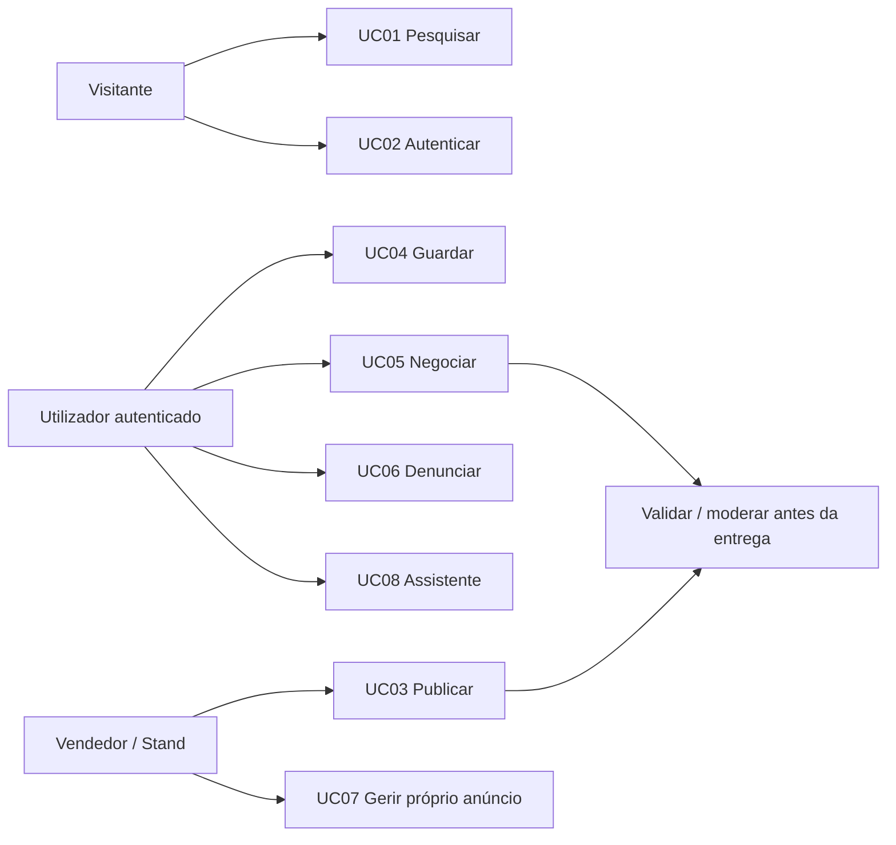

# Modelo de casos de uso — 12
| Caso | Ator | Pré-condição | Resultado / exceção |
|---|---|---|---|
| UC01 Pesquisar veículos | Visitante/Comprador | App configurada, rede | Resultados; estado vazio/erro claro |
| UC02 Autenticar e gerir perfil | Utilizador | Conta ou dados válidos de registo | Sessão e perfil; confirmação por email pode ser necessária |
| UC03 Publicar anúncio | Vendedor/Stand | Sessão; dados e foto válidos | Anúncio criado; validação/moderação pode impedir |
| UC04 Guardar favorito/pesquisa | Comprador | Sessão | Associação à conta; acesso isolado por RLS |
| UC05 Negociar por chat/proposta | Comprador/Vendedor | Anúncio/conversa acessível | Mensagem aprovada; recusada não entregue |
| UC06 Denunciar utilizador | Participante | Sessão e alvo válido | Denúncia privada para análise; limite antiabuso |
| UC07 Gerir anúncio próprio | Dono | Propriedade verificada | Editar/pausar/vendido; eliminação exige estado adequado |
| UC08 Pesquisar com IA | Utilizador | Sessão e orçamento de IA | Filtros válidos; serviço indisponível informado |
| UC09 Receber alerta | Utilizador | Consentimento, token, correspondência/evento | Notificação; leitura/cancelamento a validar |

Administrador: revisão de denúncias por ferramentas administrativas; dashboard é futuro e não se representa como entregue. Relações indicam acesso a funcionalidades, não herança de classes.
