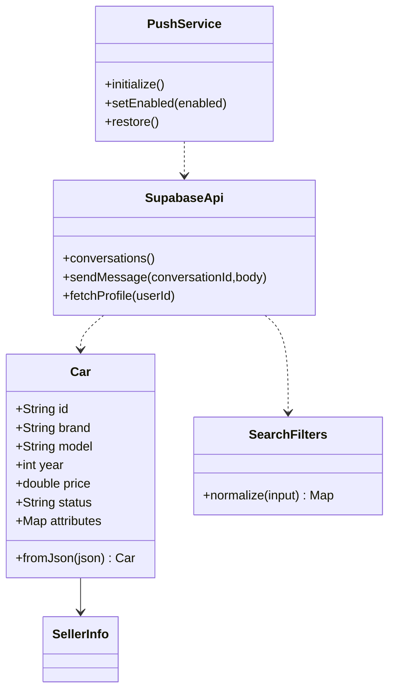

# Classes e arquitetura — 13
O diagrama separa classes Dart reais de entidades relacionais; não confunde tabelas com classes implementadas.

Fontes: lib/models/car_model.dart, search_filters.dart, lib/API/supabase_api.dart e lib/services/push_service.dart.

## Dados e fronteiras
profiles identifica pessoa pública; user_settings contém preferências. cars contém anúncios; favorites e saved_searches pertencem ao utilizador; conversations relaciona comprador, vendedor e anúncio; messages pertence à conversa; user_reports guarda denúncia/evidência com acesso restrito. Migrações são a fonte de verdade para chaves, constraints e políticas.

Cliente usa chave pública Supabase, Auth identifica o utilizador e RLS autoriza dados. Edge Functions autenticam chamadas e usam segredos para OpenAI/FCM. Dados financeiros e documentos de stands não devem ser expostos como perfil público. Papéis administrativos futuros exigem autorização no servidor.
