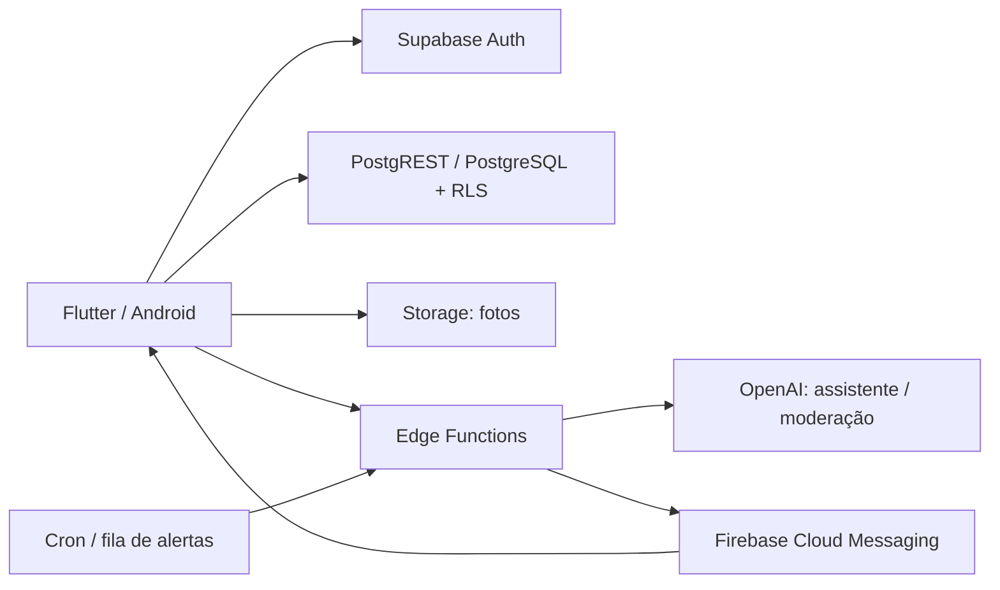

# Documento de Visão — GarageHUB
## (a) Objetivo
Marketplace de veículos: aproximar compradores, particulares e stands, com pesquisa estruturada, publicação de anúncios e negociação por mensagens. Não é um sistema de gestão de oficinas.
## (b) Escopo
Aplicação móvel Android; estrutura Flutter inclui outros destinos, mas suporte equivalente não está demonstrado. Países europeus, preços em EUR, distâncias em km. Dashboards web excluídos do âmbito desta entrega por indicação da equipa.
## (c) Partes interessadas
Visitantes pesquisam; compradores guardam anúncios/pesquisas e contactam; vendedores publicam e acompanham os seus anúncios; stands usam conta empresarial; equipa de suporte analisa denúncias. Administrador é um papel a implementar com autorização no servidor, não um utilizador que se autodeclara administrador.
## (d) Equipa
João Santos e Gonçalo Oliveira. Responsabilidade conjunta da equipa; não se atribuem retroativamente autorias individuais.
## (e) Características
Autenticação e recuperação; perfis; filtros de veículos e localização editável; anúncios com até 10 fotos, variante livre opcional até 30 caracteres e descrição até 2500; favoritos; pesquisas guardadas; mensagens e propostas; estados de envio/leitura; denúncias; estatísticas do vendedor; temas e cinco idiomas; notificações Firebase; assistente LLM.
## (f) Arquitetura de referência

Evidência: lib/API/supabase_api.dart, lib/models, lib/screens, lib/services/push_service.dart, supabase/functions e supabase/migrations. Backend usa Deno/TypeScript em Edge Functions; não foi identificado servidor Node.js próprio.
## (g) Restrições
Internet necessária para dados remotos; permissões do SO condicionam localização e push; RLS limita acesso; orçamento da IA pode esgotar; credenciais de servidor não entram na app. Envio de denúncias por email preparado mas sem fornecedor configurado. Receção de push e desempenho precisam de validação física. Não declarar qualidade de FPS apenas com testes de widgets.
## (h) Integração LLM
Assistente na Home interpreta texto natural e produz filtros/atalhos permitidos. O cliente consulta anúncios reais; o modelo não inventa inventário. Implementação vehicle-assistant usa modelo fixo gpt-6-luna e orçamento cumulativo de 2 milhões de tokens, verificado no código; disponibilidade comercial não é certificada por este documento. Segredo OpenAI exclusivamente no servidor. Histórico local de 48h. Moderação usa função separada; uma mensagem pendente só é entregue após aprovação. Aceitação: critérios válidos aplicados, resultados reais, navegação permitida e erro claro quando serviço indisponível.
